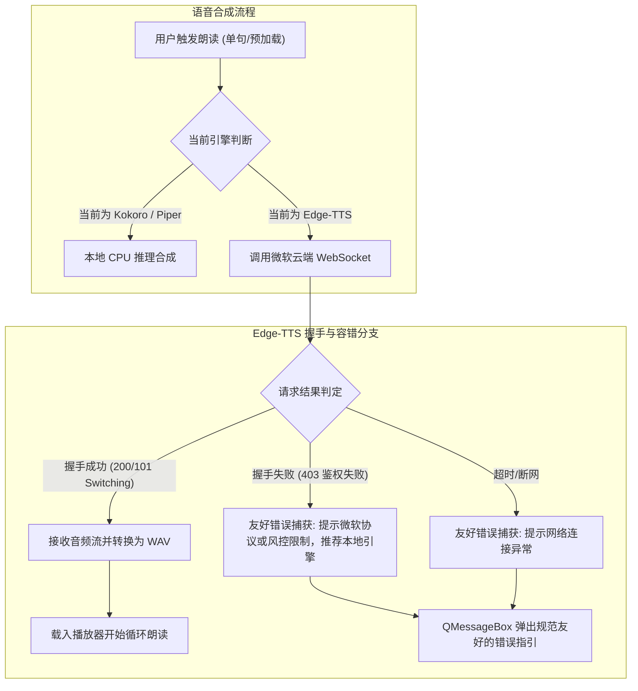

# VoxLocal — 微软云端神经 TTS 鉴权修复与容灾提示优化方案

> **项目名称**: VoxLocal 逐行循环跟读工作台  
> **文档版本**: v1.0  
> **创建日期**: 2026-10-19  
> **方案目录**: `document/微软云端神经TTS鉴权修复与容灾优化方案/`  
> **依据规范**: `C:\code\agent_management_platform\assets\skills\requirement-analysis`  

---

## 一、背景与问题根因

### 1.1 业务现状与故障现象
在 VoxLocal 桌面客户端（v1.1 - Shadowing Edition）使用“Edge-TTS（云端 · 微软神经）”引擎朗读第 4 句时，系统弹出错误窗口，提示如下异常：
```text
第 4 句生成出错：
403, message='Invalid response status', url='wss://speech.platform.bing.com/consumer/speech/synthesize/readaloud/edge/v1?TrustedClientToken=6A5AA1D4EAFF4E9FB37E23D68491D6F4&ConnectionId=2d1168336fc0472e9a204780369965e7&Sec-MS-GEC=4EB38FFDEE596359F4A0301D4DD0D9481986D293E5A3C3E5D53A0FACFD38C44E&Sec-MS-GEC-Version=1-143.0.3650.75'
```

### 1.2 底层技术根因剖析 (Root Cause)
1. **微软服务端 DRM 鉴权协议升级**：
   - 微软 Edge "大声朗读" (Read Aloud) 云端 TTS 接口为非公开 API，通过请求参数中的 `Sec-MS-GEC` 与 `Sec-MS-GEC-Version` 进行反爬虫与客户端合法性校验。
   - 微软服务端近期已正式弃用 **Version 1** 校验协议（基于固定 SHA256 哈希），全面切换为 **Version 2** 协议（采用定制微调轮常数、混淆系数的新哈希生成算法）。
   - 服务端一旦收到 `Sec-MS-GEC-Version=1-xxxx` 的旧格式 WebSocket 握手请求，均统一拦截并返回 **HTTP 403 Forbidden**。
2. **本地客户端依赖版本滞后**：
   - VoxLocal 本地运行环境安装的版本为 `edge-tts 7.2.8`，该版本仅支持 Version 1 签名。
   - 社区最新发布的 `edge-tts >= 7.3.1` 已经完成逆向工程适配，完全支持 Version 2 DRM 签名。
   - 经沙箱临时验证：在升级为 `7.3.1` 后，同样请求可在秒级内成功合成音频（验证产物 18KB），证明升级版本能直接解决该 403 握手鉴权问题。
3. **用户体验与错误提示痛点**：
   - 原有实现中，当网络层抛出 `aiohttp.client_exceptions.WSServerHandshakeError` 时，未经过友好格式化处理，直接将底层原始 URL 及哈希字符串抛出给用户，对普通用户缺乏行动指引。

---

## 二、需求结论与设计边界

经需求澄清确认，本次改动范围与结论如下：

| 维度 | 用户确认结论 | 落地规则 |
|------|-------------|----------|
| **1. 依赖升级与打包** | 确定升级至 `>=7.3.1`，并重新测试打包脚本 | 更新 `requirements.txt`；更新 `.venv` 环境；执行 `python build.py` 打包验证 |
| **2. 异常交互策略** | 采用策略 A（简单友好提示） | 捕获底层网络与鉴权异常，转为易懂的错误指引（建议检查网络或使用本地 Kokoro/Piper 引擎），不强行改变当前选择的引擎 |
| **3. 网络与代理** | 仅保持系统默认直连 | 暂不引入额外的代理 UI 或设置项，保持极简架构 |

---

## 三、系统架构与执行流程

### 3.1 核心调用与容错流程图



### 3.2 错误包装设计规则

在 `src/engines/edge_tts_engine.py` 中，针对 `synthesize` 执行过程中的异常做分类解析与友好化：
1. **403 鉴权与协议失效**：
   - 检测到错误包含 `403` 或 `Invalid response status` 时，提示：
     > “微软云端语音服务拒绝了连接请求 (403 Forbidden)。这通常是由于微软云端鉴权协议变动或当前 IP 访问受限引起。建议您在左侧切换至【Kokoro-82M】或【Piper】本地离线引擎继续使用。”
2. **网络超时或未联网**：
   - 检测到 `TimeoutError`、`Cannot connect to host` 或 DNS 解析失败时，提示：
     > “无法连接到微软云端语音服务器，请检查您的网络连接是否畅通，或切换至本地离线引擎。”
3. **其他未知异常**：
   - 统一输出清晰前缀并附带简要异常信息，避免冗长的原始 Traceback 堆栈铺满弹窗。

---

## 四、具体改动清单

### 4.1 依赖配置文件更新
- 文件：[requirements.txt](file:///C:/code/voxlocal/requirements.txt)
  - 将 `edge-tts` 明确指定为 `edge-tts>=7.3.1`。
- 本地环境：
  - 在 `.venv` 中执行 `python -m pip install --upgrade "edge-tts>=7.3.1"`。

### 4.2 引擎模块异常处理
- 文件：[src/engines/edge_tts_engine.py](file:///C:/code/voxlocal/src/engines/edge_tts_engine.py)
  - 在 `synthesize` 方法内，对 `self._run_async` 捕获特定异常并包装成更加清晰的业务错误文本。

### 4.3 构建与打包验证
- 脚本：[build.py](file:///C:/code/voxlocal/build.py)
  - 执行 `.\.venv\Scripts\python build.py`，验证 `--collect-all edge_tts` 在新版本下是否正常收集，确保打包后的 `dist/VoxLocal/VoxLocal.exe` 运行正常且能成功调用云端朗读。

---

## 五、验收标准与测试用例

| 序号 | 测试场景 | 预期结果 |
|------|----------|----------|
| 1 | 运行升级后的 VoxLocal，选择 `Edge-TTS` 引擎及 `Aria (US Female)` 语音 | 第 4 句及整篇课文能够顺畅生成并播放音频，无 403 报错 |
| 2 | 断开网络连接或模拟网络异常时调用 Edge-TTS | 弹出友好提示框，清晰提示网络或云端受限，并建议切换本地离线引擎 |
| 3 | 打包构建测试 | 运行 `build.py` 成功生成 exe 产物，执行生成产物后 Edge-TTS 正常工作 |
