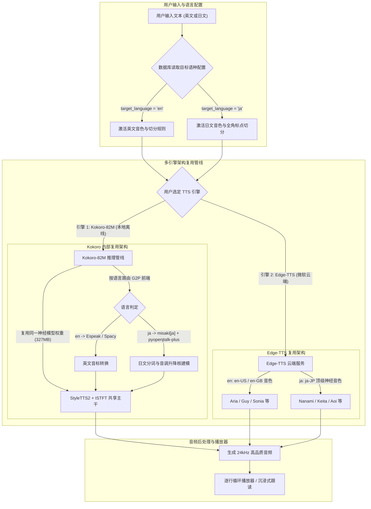
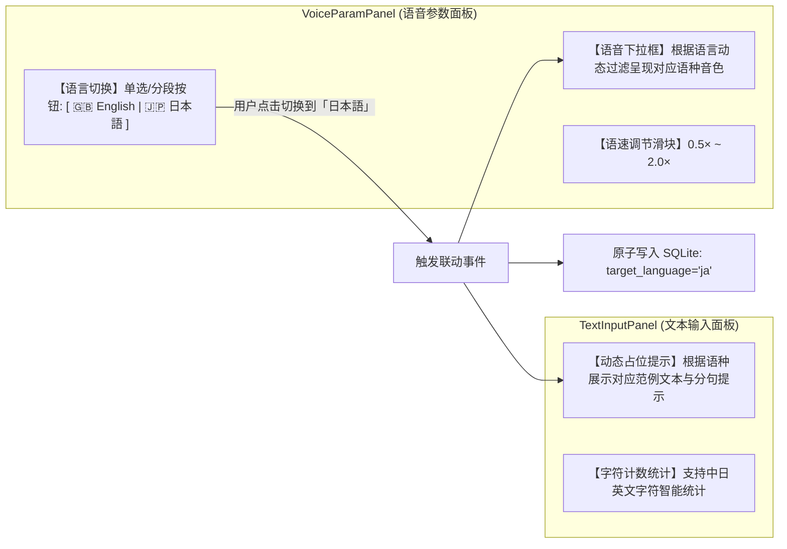
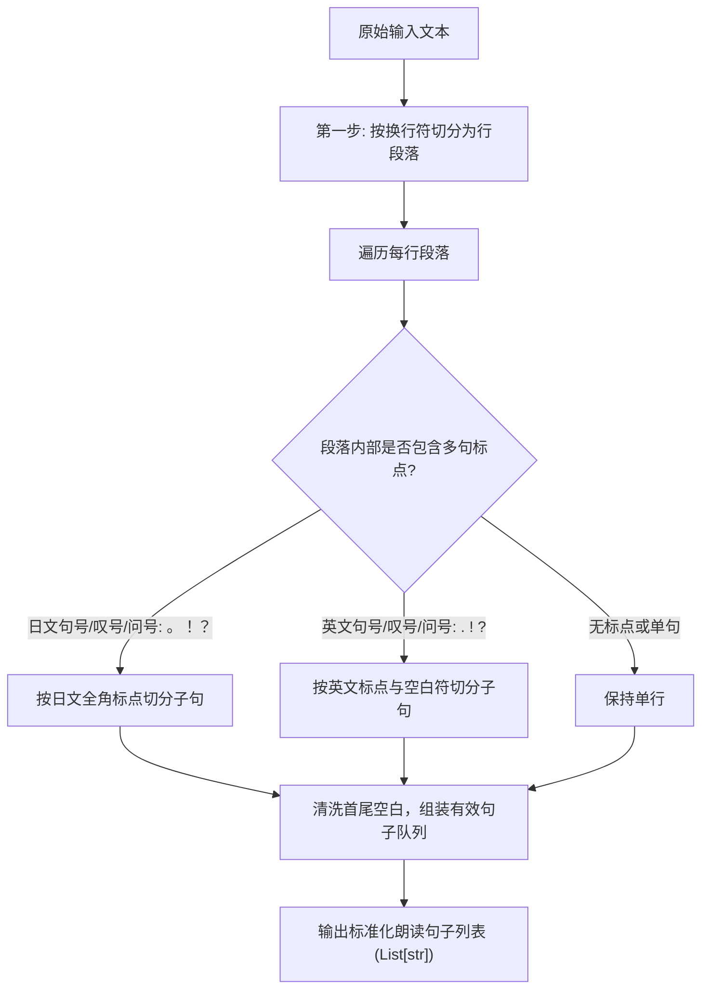

# VoxLocal — 日文语音合成与双语架构扩展方案 需求方案设计

> **项目代号**: VoxLocal  
> **文档版本**: v1.0  
> **创建日期**: 2026-10-19  
> **目标平台**: Windows 11 (x64, Intel i5-8350U 无独显环境)  
> **当前状态**: 待用户正式审核与授权

---

## 一、背景与业务诉求

### 1.1 需求背景
VoxLocal 当前作为一款支持本地离线推理与云端高质量对照的 TTS 桌面应用，主要面向英文文本的逐行循环朗读与沉浸式跟读。目前底层 Kokoro-82M 引擎与 Edge-TTS 引擎仅开放并注册了美式英语与英式英语音色列表，UI 与跟读文本切分逻辑也完全围绕英文标点设计。

用户提出明确扩展需求：
1. **支持日文语音合成**：使系统具备高自然度、纯正语调的日文文本合成能力；
2. **模型架构 100% 复用**：无需引入重量级新框架或重构声学模型架构，最大限度沿用现有的轻量级本地离线推理管线与云端通道；
3. **英日双语并存与配置持久化**：用户可在界面中明确选择目标语种（英文/日文），切换日文后即激活日文语音合成与交互，该语言偏好配置必须持久化写入本地 SQLite 数据库；
4. **逐行循环跟读全兼容**：无论是日文文本还是英文文本，必须全面支持断句切分、逐行朗读与无缝循环跟读。

### 1.2 硬件约束与可行性前提

| 硬件维度 | 配置规格 | 影响与设计决策 |
| :--- | :--- | :--- |
| **CPU** | Intel Core i5-8350U (4C8T, 移动低压) | 算力受限，严禁引入 BERT-VITS2 / CosyVoice 等重型 PyTorch 引擎 |
| **GPU** | Intel UHD 620 (集显，无 CUDA) | 本地推理必须能在纯 CPU 下流畅执行（实时率 RTF 满足交互要求） |
| **操作系统** | Windows 11 专业版 (x64) | 缺乏 MSVC C++ 编译环境，日文前端必须采用免编译二进制 Wheel |
| **Python** | 3.11.9 (虚拟环境 `.venv`) | 已内置 `kokoro 0.9.4`、`misaki 0.9.4`、`PySide6`、`soundfile` |

---

## 二、模型架构复用与引擎技术方案



### 2.1 本地主力引擎：Kokoro-82M 日文架构 100% 复用机制

1. **核心模型权重完全共享**：
   - Kokoro-82M 官方模型 (`kokoro-v0_19.pth`) 底层统一建模了多语种国际音标（IPA）表征，英文（`lang_code="a"` / `"b"`）与日文（`lang_code="j"`）共享完全相同的 StyleTTS2 解码器与 ISTFT 逆声码器权重（~327MB），无需下载重复模型。
2. **多语言 Pipeline 动态缓存**：
   - 现有的 `KokoroEngine._pipeline_cache` 机制天然支持多语言。调用 `_load_pipeline("j")` 时，`KPipeline` 会在内存中按需懒加载日文处理链，与英文缓存互不干扰。
3. **Windows 离线环境下的前端依赖破局（`pyopenjtalk-plus`）**：
   - Kokoro 的日文音素化依赖 `misaki[ja]`，其底层需调用 `pyopenjtalk` 进行 MeCab 分词和音调高低核标记（Pitch Accent）。
   - 由于官方 `pyopenjtalk` 源码包在 Windows 下编译需要 MSVC 和 CMake，本方案采用预构建二进制轮子 **`pyopenjtalk-plus`**。
   - `pyopenjtalk-plus` 提供了与官方完全一致的 CPython 3.11 预编译二进制 Wheel（包含预建 OpenJTalk 字典），免除本地编译，实现 100% 离线顺畅运行。

### 2.2 云端对照引擎：Edge-TTS 微软日文神经音色扩展
- 复用现有的异步合成、断线重试与音频转换架构。
- 将微软官方极受好评的 `ja-JP` 旗舰神经网络发音人无缝纳入音色注册表，提供超逼真的日语音色对比。

---

## 三、音色库清单与语种分类

### 3.1 Kokoro-82M 音色配置（5 个官方日文音色全量纳入）

| 语音 ID (`voice_id`) | 显示名称 (`display_name`) | 语种 (`language`) | 性别 (`gender`) | 特点风格 |
| :--- | :--- | :--- | :--- | :--- |
| **`jf_alpha`** | **Alpha (JA Female, 默认)** | **ja-JP** | **Female** | **清亮自然，播报标准，推荐作为日文默认音色** |
| `jf_gongitsune` | Gongitsune (JA Female) | ja-JP | Female | 叙事感强，富有情感与童话韵律 |
| `jf_nezumi` | Nezumi (JA Female) | ja-JP | Female | 轻快活泼，语调清脆 |
| `jf_tebukuro` | Tebukuro (JA Female) | ja-JP | Female | 温柔和缓，适合伴读 |
| `jm_kumo` | Kumo (JA Male) | ja-JP | Male | 沉稳大气，标准日文男声 |

### 3.2 Edge-TTS 云端日文音色配置（精选微软顶级神经网络发音人）

| 语音 ID (`voice_id`) | 显示名称 (`display_name`) | 语种 (`language`) | 性别 (`gender`) | 特点风格 |
| :--- | :--- | :--- | :--- | :--- |
| **`ja-JP-NanamiNeural`** | **Nanami (JA Female, 七海)** | **ja-JP** | **Female** | **微软日文旗舰女声，极度自然流畅（默认）** |
| `ja-JP-KeitaNeural` | Keita (JA Male, 圭太) | ja-JP | Male | 阳光青年男声，清晰自然 |
| `ja-JP-AoiNeural` | Aoi (JA Female, 葵) | ja-JP | Female | 柔和细腻，治愈系语调 |
| `ja-JP-DaichiNeural` | Daichi (JA Male, 大地) | ja-JP | Male | 成熟稳重，电台质感 |
| `ja-JP-MayuNeural` | Mayu (JA Female, 真由) | ja-JP | Female | 动漫轻快风，富有辨识度 |
| `ja-JP-NaokiNeural` | Naoki (JA Male, 直树) | ja-JP | Male | 正式播音员风范 |
| `ja-JP-ShioriNeural` | Shiori (JA Female, 诗织) | ja-JP | Female | 知性从容，温润清雅 |

---

## 四、数据持久化与数据库设计

在 [src/core/history_db.py](file:///c:/code/voxlocal/src/core/history_db.py) 中扩展配置持久化能力，保证系统在重新启动后记住用户的语言偏好。

### 4.1 表结构设计 (`app_settings`)

```sql
CREATE TABLE IF NOT EXISTS app_settings (
    key         TEXT PRIMARY KEY,
    value       TEXT NOT NULL,
    updated_at  TEXT NOT NULL DEFAULT (datetime('now', 'localtime'))
);
```

### 4.2 核心配置项键值规范

| 配置项 Key | 可选值 / 数据格式 | 默认值 | 作用说明 |
| :--- | :--- | :--- | :--- |
| `target_language` | `'en'` 或 `'ja'` | `'en'` | 用户当前选定的全局主语种 |
| `last_voice_en` | 字符串 (如 `'af_heart'`) | `'af_heart'` | 英文模式下最后使用的音色 |
| `last_voice_ja` | 字符串 (如 `'jf_alpha'`) | `'jf_alpha'` | 日文模式下最后使用的音色 |
| `last_speed` | 浮点字符串 (如 `'1.0'`) | `'1.0'` | 上次使用的朗读语速 |

### 4.3 数据库 API 扩充
- `get_setting(key: str, default: str = "") -> str`
- `set_setting(key: str, value: str) -> None`（使用 `INSERT INTO ... ON CONFLICT(key) DO UPDATE` 保证原子性）

---

## 五、UI 界面交互与联动逻辑



### 5.1 语音面板交互升级
1. **新增【目标语种】选择器**：
   - 位于语音选择下拉框正上方，采用精致的高光切换按钮组：`English (英语)` 与 `日本語 (日语)`。
   - 切换时立即持久化保存至数据库。
2. **语音下拉框动态联动**：
   - 选中 `English` 时：下拉列表仅呈现 `en-US`、`en-GB` 等英文分组音色，默认高亮记录的 `last_voice_en`。
   - 选中 `日本語` 时：下拉列表立即过滤刷新为 `ja-JP` 日文音色分组，默认高亮记录的 `last_voice_ja`（如 `jf_alpha` 或 `ja-JP-NanamiNeural`）。
   - 彻底避免在 30 多个音色的混合长列表中繁琐翻找。

### 5.2 文本输入面板的动态引导
- 处于英文模式时：展示英文跟读示例（如 "The quick brown fox jumps..."）。
- 切换为日文模式时：动态更新占位符为地道日文范例（如「吾輩は猫である。名前はまだ無い。\nどこで生れたかとんと見当がつかぬ。」），并提示用户可按换行或句号 `。` 智能断句跟读。

---

## 六、文本断句与逐行跟读算法增强（中日英全兼容）

[LineReaderManager](file:///c:/code/voxlocal/src/core/line_reader.py) 是 VoxLocal 逐行循环朗读和沉浸式跟读的核心控制器。为了完美支撑日文跟读，断句逻辑做如下增强：



### 6.1 断句规则定义
1. **多行与空行清洗**：
   - 保留原有的多行切分优先级：文本中显式的换行符优先视为独立行。
2. **行内全角/半角标点细分（智能分句模式）**：
   - 支持对粘连长文本按标点拆句：
     - 日文分句定界符：`。`、`！`、`？`、`……`、`\n`
     - 英文分句定界符：`. `、`! `、`? `、`\n`
   - 保留标点符号本身，避免切分后句子缺失语调停顿标记。
3. **逐行无限次循环与预加载**：
   - 无论日文还是英文，朗读第 $N$ 行时，播放器循环播放当前行；
   - 后台线程池异步预合成第 $N+1$ 行音频并放入内存缓存，实现下一句切换“零卡顿”无缝播放。

---

## 七、异常处理、边界防护与风控机制

1. **依赖缺失容错检测**：
   - 在 `KokoroEngine.is_available()` 中增加对日文支持情况的细粒度探测：
     - 若 `kokoro` 已就绪但缺少 `pyopenjtalk` / `misaki.ja`，系统不报错闪退，而是在状态栏友好提示：`Kokoro 英文就绪；日文需安装: pip install pyopenjtalk-plus`；
     - 当用户在日文模式下尝试合成时，弹出引导对话框并提供一键复制命令，杜绝崩溃。
2. **文本语种错配容错**：
   - 若用户在日文模式下输入了包含罗马音、英文单词或数字的日文文本（如 `iPhoneの価格は12万円です`），`misaki[ja]` 与 `num2kana` 会自动转写数字为假名，并优雅降级发音，避免引发底层抛错。
3. **并发与音频安全**：
   - 日文与英文共用全局临时音频清理机制（`AudioManager.cleanup_old_temp_files()`），保证磁盘空间不随长期跟读无限膨胀。

---

## 八、代码改动受影响模块清单

> [!NOTE]
> 方案审核通过前，以下代码文件均保持未修改状态。审核通过后将依序推进：

| 模块文件 | 改动内容与核心职责 |
| :--- | :--- |
| `requirements.txt` | 增加 `pyopenjtalk-plus` 依赖声明 |
| [src/core/history_db.py](file:///c:/code/voxlocal/src/core/history_db.py) | 新增 `app_settings` 配置表及 `get_setting` / `set_setting` 接口 |
| [src/engines/kokoro_engine.py](file:///c:/code/voxlocal/src/engines/kokoro_engine.py) | 扩充 5 个日文音色常量，并在 `is_available` 中校验日文环境支持 |
| [src/engines/edge_tts_engine.py](file:///c:/code/voxlocal/src/engines/edge_tts_engine.py) | 扩充 7 个微软官方高质量日文音色 |
| [src/core/line_reader.py](file:///c:/code/voxlocal/src/core/line_reader.py) | 增强分句算法，原生支持全角标点（`。！？`）切分 |
| [src/ui/voice_panel.py](file:///c:/code/voxlocal/src/ui/voice_panel.py) | 增加「语种切换」控件（English / 日本語），实现语音下拉框联动过滤 |
| [src/ui/text_input_panel.py](file:///c:/code/voxlocal/src/ui/text_input_panel.py) | 增加多语种占位符引导，优化日文字数统计 |
| [src/ui/main_window.py](file:///c:/code/voxlocal/src/ui/main_window.py) | 启动时读取数据库默认语种，绑定语种切换与持久化逻辑 |

---

## 九、审核与确认指令说明

根据开发规范要求，本需求方案文档已正式保存落盘。在获得您的明确同意前，**绝对不开始编写任何业务代码**。
