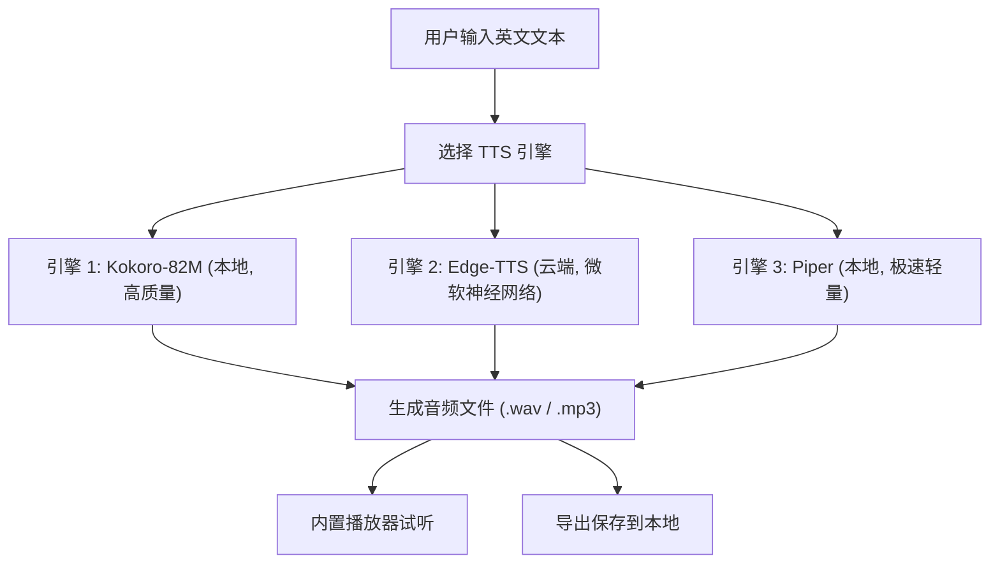
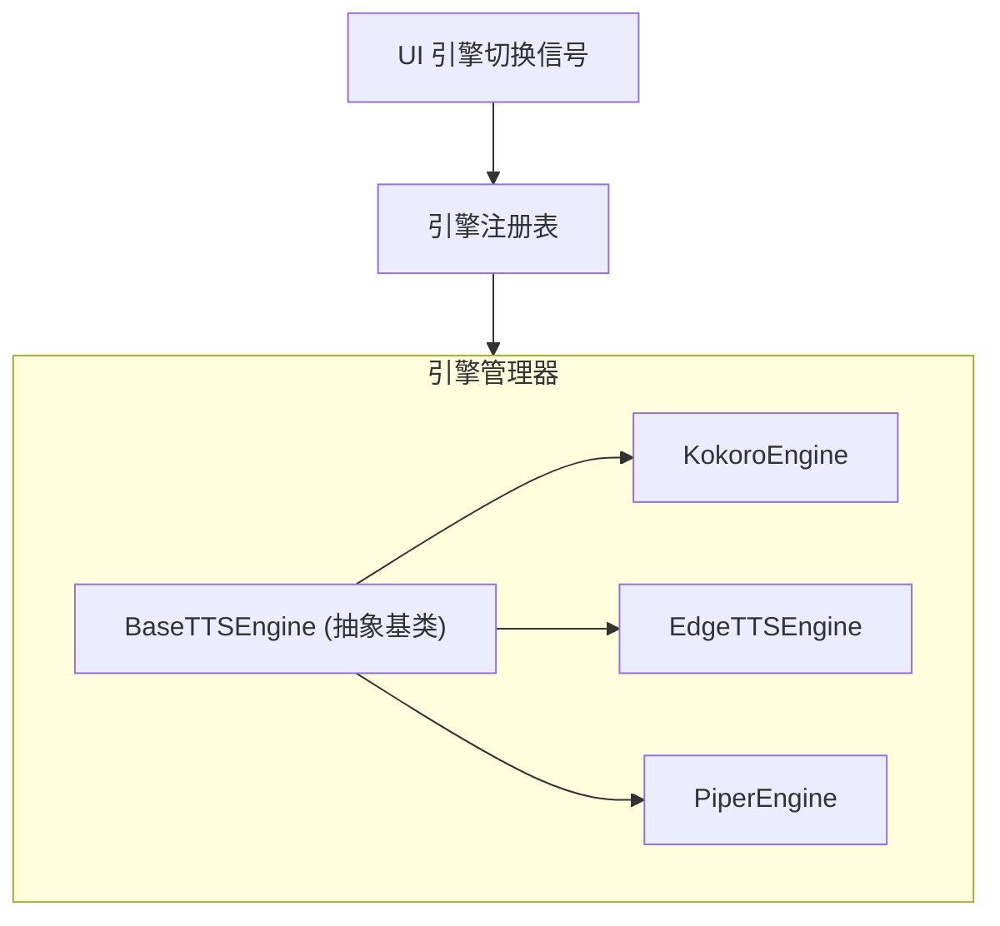

# VoxLocal — 本地语音合成桌面应用 需求方案设计

> **项目代号**: VoxLocal
> **文档版本**: v1.0
> **创建日期**: 2026-09-26
> **目标平台**: Windows 11 (x64)

---

## 一、背景与痛点

### 1.1 用户诉求
用户希望在本地电脑上拥有一个**输入英语文本、输出自然语调音频**的桌面工具，未来需要扩展支持日文。要求语调接近真人朗读水平，质量优先于速度。

### 1.2 硬件约束

| 项目 | 配置 |
|------|------|
| CPU | Intel Core i5-8350U @ 1.70GHz (4C8T, 移动低压) |
| 内存 | 16 GB |
| GPU | Intel UHD Graphics 620 (**集显，无独立显卡，无 CUDA**) |
| 磁盘 | C 盘 475GB，可用约 269GB |
| 系统 | Windows 11 专业版 |
| Python | 当前 3.8.6，可安装新版本 |

> [!IMPORTANT]
> **核心硬件限制**：无 NVIDIA 独立显卡，所有 TTS 引擎必须在纯 CPU 环境下运行。这排除了需要 CUDA 的重型模型（如 XTTS v2、GPT-SoVITS 等），方案选型聚焦于 **CPU 友好的轻量级高质量模型 + 云端 API 备选**。

---

## 二、核心设计方案：多引擎可切换架构

### 2.1 整体架构

采用**多引擎可切换**架构，用户可在 UI 中自由选择不同 TTS 引擎，自行对比效果后选用最满意的方案。



### 2.2 三大 TTS 引擎对比

| 维度 | Kokoro-82M | Edge-TTS | Piper |
|------|-----------|----------|-------|
| **运行方式** | 纯本地 CPU 推理 | 调用微软云端 API | 纯本地 CPU 推理 |
| **模型大小** | ~327MB | 无需下载模型 | 50~100MB/语音 |
| **语音质量** | ⭐⭐⭐⭐⭐ 接近真人 | ⭐⭐⭐⭐⭐ 微软顶级 | ⭐⭐⭐⭐ 良好 |
| **合成速度** | 中速（CPU 下稍慢） | 快（依赖网络） | 极快 |
| **是否联网** | ❌ 完全离线 | ✅ 需要联网 | ❌ 完全离线 |
| **英文语音数** | 28 个（美式 20 + 英式 8） | 300+ 多语种 | 数十个 |
| **日文扩展** | ✅ 原生支持（安装 misaki[ja]） | ✅ 支持（ja-JP 语音） | ⚠️ 需第三方 fork |
| **许可证** | Apache 2.0 | 免费但非官方 API | MIT |
| **推荐定位** | 🏆 **主力离线引擎** | 🥈 **高质量云端备选** | 🥉 **极速离线备选** |

### 2.3 推荐优先级
1. **Kokoro-82M（首选主力）**：当前 CPU TTS 领域的"黄金标准"，82M 参数即可实现接近真人的自然语调，纯 CPU 运行，且原生支持日文扩展
2. **Edge-TTS（云端对照组）**：微软 Edge 浏览器内置的神经网络 TTS，质量极高，免费无需 API Key，作为联网环境下的高质量对比选项
3. **Piper（极速备选）**：速度最快、资源占用最低，适合需要快速批量生成的场景

---

## 三、产品形态与交付规范

### 3.1 产品形态
- **独立桌面 GUI 应用**：基于 Python 开发，使用 PySide6 构建 GUI
- **打包为 .exe**：遵循 `python_exe_build_skill.md` 规范，使用 PyInstaller 打包为 Windows EXE
- **互联网审美**：现代深色主题，渐变色彩，圆角卡片，微动画交互，参考当下流行的桌面端设计风格

### 3.2 UI 设计方向


#### 核心 UI 元素
1. **引擎切换区**：标签页或下拉菜单，快速切换 Kokoro / Edge-TTS / Piper
2. **文本输入区**：大尺寸文本编辑框，支持直接粘贴长文，显示字数统计
3. **语音参数面板**：
   - 语音选择（下拉列表，按引擎动态更新可用语音）
   - 语速调节（滑块，0.5x ~ 2.0x）
4. **生成 & 播放区**：
   - "生成语音"按钮（带进度指示）
   - 内嵌音频播放器（播放/暂停/进度条）
   - "保存文件"按钮（支持 .wav / .mp3 格式选择）
5. **状态栏**：显示当前引擎加载状态、模型下载进度、生成耗时

### 3.3 视觉风格
- **主题**：深色模式为主，支持明暗切换
- **配色方案**：
  - 主色：深蓝渐变到紫色 (#1a1a2e → #16213e → #0f3460)
  - 强调色：亮青色 (#00d2ff) / 渐变紫色 (#7a5cfa)
  - 文本：白色/浅灰 (#e0e0e0)
- **卡片式布局**：圆角卡片 (border-radius: 12px)，玻璃拟态效果 (glassmorphism)
- **微动画**：按钮悬停渐变，生成中脉冲动画，切换引擎时平滑过渡
- **字体**：使用系统默认 + Inter / Noto Sans CJK 备选

---

## 四、功能模块详细设计

### 4.1 引擎管理模块



- **抽象基类 `BaseTTSEngine`**：定义统一接口
  - `synthesize(text: str, voice: str, speed: float) -> bytes`
  - `list_voices() -> List[VoiceInfo]`
  - `get_engine_name() -> str`
  - `is_available() -> bool`（检查依赖是否就绪）
- **引擎注册表**：动态注册可用引擎，引擎加载失败时优雅降级（UI 中置灰不可选并提示原因）

### 4.2 Kokoro 引擎实现要点
- **Python 版本**：需要 Python 3.10 ~ 3.12
- **系统依赖**：需安装 espeak-ng（Windows .msi 安装包）
- **核心依赖**：`kokoro>=0.9.4`, `soundfile`, `torch` (CPU 版本)
- **语音列表**：
  - 美式英语 (20 个)：`af_heart`, `af_bella`, `af_alloy`, `am_adam`, `am_michael` 等
  - 英式英语 (8 个)：`bf_emma`, `bm_george`, `bm_daniel` 等
- **初始化**：`KPipeline(lang_code='a')` (美式英语)
- **日文扩展预留**：安装 `misaki[ja]` 后使用 `KPipeline(lang_code='j')`

### 4.3 Edge-TTS 引擎实现要点
- **依赖**：`edge-tts`（纯 Python，无额外系统依赖）
- **联网要求**：需要互联网连接（调用微软 Edge 朗读 API）
- **语音推荐**：
  - 英语：`en-US-AriaNeural`, `en-US-GuyNeural`, `en-GB-SoniaNeural`
  - 日文 (未来)：`ja-JP-NanamiNeural`
- **注意**：非官方 API，个人使用免费，不保证 SLA

### 4.4 Piper 引擎实现要点
- **依赖**：`piper-tts`
- **模型文件**：需下载 `.onnx` + `.onnx.json` 文件对
- **推荐语音**：`en_US-lessac-high`, `en_GB-vctk-medium`
- **优势**：合成速度极快，适合批量处理

### 4.5 音频处理模块
- **输出格式**：默认 WAV (24kHz, 16-bit)，可选导出 MP3
- **内嵌播放器**：使用 PySide6 `QMediaPlayer` 播放生成的音频
- **文件保存**：支持选择保存路径，默认保存到 `Documents/VoxLocal/output/`

### 4.6 历史记录模块（SQLite）
- 遵循 `python_exe_build_skill.md` 的数据库硬约束
- 存储路径：`<AppData>/VoxLocal/db/history.db`
- 记录每次合成的：文本内容、使用引擎、语音名称、生成时间、音频文件路径
- WAL 模式 + 线程锁 + 原子 Upsert

---

## 五、技术栈与环境规划

### 5.1 Python 环境
- **推荐版本**：Python 3.11（兼容 Kokoro、Piper、edge-tts 所有依赖）
- **虚拟环境**：使用 `venv` 隔离项目依赖
- **安装路径建议**：`C:\Python311\python.exe`（独立于现有 3.8.6）

### 5.2 核心依赖清单

```
# TTS 引擎
kokoro>=0.9.4
soundfile
torch               # CPU 版本
edge-tts
piper-tts

# GUI
PySide6

# 音频处理
soundfile
pydub               # MP3 导出 (依赖 ffmpeg)

# 数据库
# sqlite3 (Python 内置，无需安装)

# 打包
pyinstaller
pillow              # 图标生成
```

### 5.3 系统级依赖
- **espeak-ng**：Kokoro 所需的音素处理引擎（Windows .msi 安装包）
- **ffmpeg**（可选）：MP3 格式导出所需，放置于项目 `bin/` 目录

---

## 六、项目目录结构

```
c:\code\voxlocal\
├── src/
│   ├── main.py                   # 主入口
│   ├── assets/
│   │   ├── app.ico               # 应用图标 (7 级多分辨率)
│   │   ├── app.png               # 高清原图 (512x512)
│   │   └── styles/
│   │       └── theme.qss         # Qt 样式表
│   ├── ui/
│   │   ├── main_window.py        # 主窗口
│   │   ├── text_input_panel.py   # 文本输入面板
│   │   ├── engine_selector.py    # 引擎选择器
│   │   ├── voice_panel.py        # 语音参数面板
│   │   ├── player_panel.py       # 播放器面板
│   │   └── status_bar.py         # 状态栏
│   ├── engines/
│   │   ├── base_engine.py        # 抽象基类
│   │   ├── kokoro_engine.py      # Kokoro-82M
│   │   ├── edge_tts_engine.py    # Edge-TTS
│   │   └── piper_engine.py       # Piper
│   ├── core/
│   │   ├── audio_manager.py      # 音频处理与导出
│   │   └── history_db.py         # SQLite 历史记录
│   └── utils/
│       ├── paths.py              # 路径管理 (遵循 EXE Skill 规范)
│       └── single_instance.py    # 单例运行守护
├── bin/
│   └── ffmpeg.exe                # (可选) MP3 导出工具
├── document/
│   └── 本地语音合成服务方案/
│       └── 方案设计.md            # 本文档
├── build.py                      # PyInstaller 打包脚本
├── build.ps1                     # 自动化构建脚本
├── requirements.txt              # 依赖清单
└── .gitignore
```

---

## 七、开发分期规划

### Phase 1：MVP 核心功能（当前阶段）
- [x] 项目结构搭建
- [ ] PySide6 主界面框架（深色主题 + 互联网审美）
- [ ] Kokoro-82M 引擎集成（英文）
- [ ] Edge-TTS 引擎集成
- [ ] 引擎切换与语音选择
- [ ] 文本输入 → 语音生成 → 播放 → 保存完整链路
- [ ] SQLite 历史记录
- [ ] PyInstaller EXE 打包

### Phase 2：体验增强
- [ ] Piper 引擎集成
- [ ] 批量文本处理（按段落分割长文）
- [ ] 语速/音调微调
- [ ] 生成历史列表与快速重播

### Phase 3：日文扩展
- [ ] Kokoro 日文引擎（`misaki[ja]` + `lang_code='j'`）
- [ ] Edge-TTS 日文语音
- [ ] 语言自动检测（英/日）

---

## 八、风险与应对

| 风险 | 影响 | 应对措施 |
|------|------|---------|
| Kokoro CPU 推理速度慢（i5-8350U 低压 CPU） | 长文本生成等待时间较长 | 异步线程处理 + 进度条；优先推荐 Edge-TTS 处理长文 |
| Edge-TTS 非官方 API 可能被封禁 | 云端引擎不可用 | 作为备选方案而非唯一方案；本地 Kokoro 可独立工作 |
| PyTorch CPU 版本体积大（~200MB+） | EXE 打包体积膨胀 | 使用 `--exclude-module` 剪枝无关模块；考虑 ONNX Runtime 替代 |
| espeak-ng 系统依赖安装 | 首次部署需额外步骤 | 文档明确指引；或将 espeak-ng DLL 打入包内 |
| Python 3.8 → 3.11 升级 | 需新安装 Python | 独立安装 Python 3.11，不影响现有 3.8 环境 |

---

## 九、EXE 打包规范（遵循 python_exe_build_skill.md）

打包严格遵循项目已有的 `python_exe_build_skill.md` 规范，包括但不限于：
- 专属应用图标（7 级多分辨率 .ico）
- Win32 AppUserModelID 注入
- 单例运行 Named Mutex 守护
- 三类路径管理（`_MEIPASS` / `app_root` / `user_data_dir`）
- SQLite 数据库 WAL 模式持久化
- `build.py` + `build.ps1` 双层构建架构
- 剪枝排除未使用的 Qt/PyTorch 子模块

---

## 十、验收标准

1. **功能验收**：输入英文文本 → 选择引擎和语音 → 点击生成 → 可播放自然语调的音频 → 可保存为文件
2. **质量验收**：Kokoro 引擎生成的语音语调自然，接近真人朗读
3. **UI 验收**：深色主题现代化设计，操作流畅，符合互联网审美标准
4. **打包验收**：双击 .exe 可直接运行，专属图标，无多开问题
5. **扩展验收**：架构支持后续添加日文引擎，无需重构核心代码
