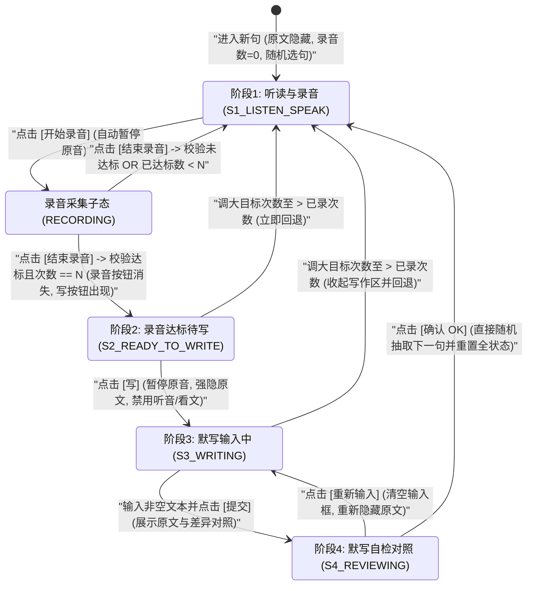
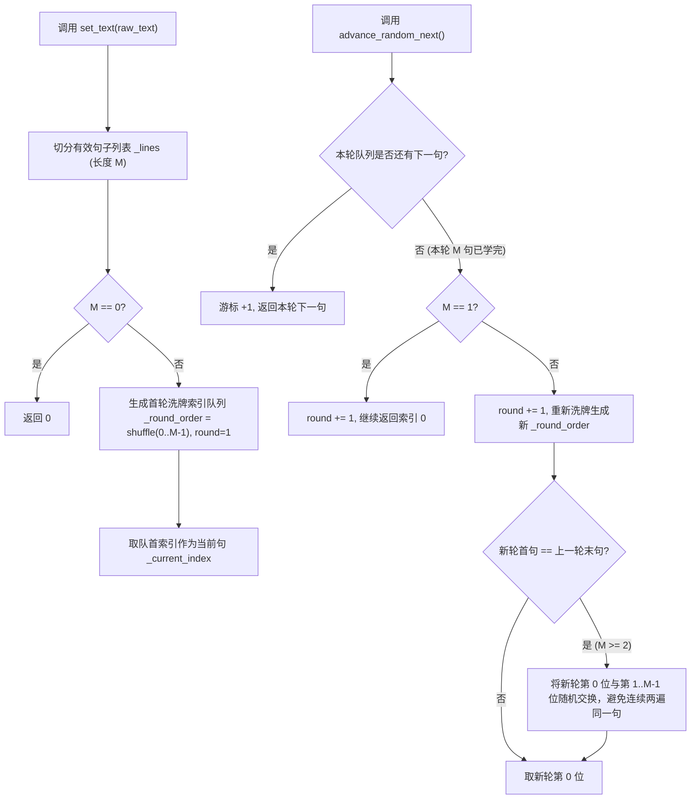

# 沉浸跟读台「听说读写」全闭环与无限乱序循环方案设计

## 一、需求背景与业务定位

### 1.1 背景与痛点
当前 VoxLocal 的「沉浸跟读台」（`FocusReadPanel`）采用“直接展示原文 + 无限循环朗读 + 点击【上一个/下一个】自由切换”的纯输入模式，在实际外语（英语 / 日语）精听与记忆训练中存在以下短板：
1. **缺少盲听训练**：一进入句子就展示全文，学习者容易依赖视觉阅读，无法锻炼纯粹的“听音辨义”能力；
2. **缺乏强制开口输出（说）**：点击切换按钮即可跳过当前句，没有麦克风录音与朗读次数门禁，容易流于“只听不张嘴”；
3. **缺乏拼写/听写闭环（写）**：只听不写无法检验对词汇拼写、日语假名/汉字的真实掌握度；
4. **顺序记忆惯性**：固定从第 1 句顺排到最后 1 句容易形成机械顺序记忆，且末尾存在终点中断，缺乏高强度乱序随机强化。

### 1.2 业务目标
将「沉浸跟读台」重构为**“输入（听/读）→ 开口输出（说/录音）→ 书面输出（写/自检）→ 确认 OK 直通下一句”**的严格学习闭环与**无限乱序循环**工作台：
- **盲听优先**：进入任意句子默认隐藏原文（显示盲听引导提示），支持手动切换【展示原文 / 隐藏原文】；
- **强制开口录音**：移除【上一个】【下一个】按钮；在完成设定次数（3 ~ 10 次可配置，默认 3 次）的有效录音之前，不允许进入写作阶段；支持最近 1 次录音的即时回放对比；
- **防作弊默写与自检**：录音达标后录音按钮消失、出现【写】按钮；进入写作态后强制隐藏原文并禁用所有音频播放/回放功能；提交后展示“我的输入 vs 正确原文”对照供学习者自行判定【确认 OK】或【重新输入】；
- **确认即切换 + 无限乱序循环**：点击【确认 OK】后直接切换至下一句；全量句子按“整轮洗牌无重复 + 跨轮无限循环”乱序抽取（首句即随机），永不出现完结中断。

---

## 二、需求澄清决策矩阵

| 维度 | 最终决策 | 详细约束说明 |
| :--- | :--- | :--- |
| **导航与切句机制** | **移除【上一个】与【下一个】，无限乱序循环** | 控制栏移除【⏮ 上一个】和【⏭ 下一个】；开始学习第 1 句即随机抽取；一轮内洗牌遍历所有句子不重复，一轮结束后自动重新洗牌进入下一轮（若文本库仅 1 句则重复该句并重置状态）；写作自检点击【✅ 确认 OK】后直接切入下一句。 |
| **原文盲听显隐** | **默认隐藏 + 手动切换 + 阶段强锁** | 新句进入时默认隐藏原文，中央卡片显示：`🎧 盲听中，请专注听音输入…`；提供【👁️ 展示原文 / 🙈 隐藏原文】按钮可反复切换；进入“写”阶段或点击“重新输入”时强制隐藏原文并禁用展示按钮。 |
| **录音交互方式** | **点击切换式 + 仅留最新 1 次回放** | 句子进入即刻显示【🎙️ 开始录音 (k/N)】；点击开始录制（自动暂停原音循环），按钮变为【⏹ 结束录音】；再次点击停止（自动恢复原音循环）；仅保留最近 1 次有效录音文件供【🔊 回放我的录音】，旧录音立即清理。 |
| **录音有效性判定** | **轻量音频双阈值判定** | 每次录音须同时满足：**有效时长 ≥ 1.0 秒** 且 **有效音频振幅高于静音底噪阈值**（`RMS ≥ 0.008` 或 `Peak ≥ 0.025`，基于归一化 `float32` PCM）；不达标则提示并丢弃，不计入次数。 |
| **朗读次数配置** | **控制栏配置 3~10 次 + 持久化 + 动态回退** | 在沉浸跟读台控制栏提供 `目标朗读次数` 微调框（范围 `3 ~ 10`，默认 `3`），持久化保存至 SQLite `app_settings`；学习中修改配置实时重算进度，若调高导致当前已录次数 `< 目标次数`，立即回退至录音阶段（隐藏写按钮/收起写作区，恢复录音按钮）。 |
| **麦克风异常兜底** | **严格报错阻断** | 若系统无可用麦克风、设备被占用或读取失败，弹出明确中文错误提示，当前次数不增加，严禁绕过或放行。 |
| **“写”的形态与防作弊** | **键盘听写/默写 + 禁止听音看文** | 仅支持键盘文本输入框默写（不支持手写）；点击【✍️ 写】进入写作态时，自动暂停原音并禁用【播放/暂停】、【重播本句】、【回放我的录音】与【展示原文】；空文本或纯空格拦截禁止提交。 |
| **“写”后自检闭环** | **输入/原文对照 + 自判 OK / 重输** | 点击【📩 提交】后展示“我的输入”与“正确原文”（附逐词/逐字差异高亮），提供【✅ 确认 OK】与【🔄 重新输入】；点【🔄 重新输入】清空输入框并再次隐藏原文；点【✅ 确认 OK】直接进入下一随机句子。 |

---

## 三、核心交互流程与状态机设计

### 3.1 四阶段状态机流转图

### 3.2 各阶段按钮显隐与可用性契约表

| 控件名称 | S1 听读/录音态 | RECORDING 录音中 | S2 录音达标待写态 | S3 默写输入态 | S4 自检对照态 |
| :--- | :--- | :--- | :--- | :--- | :--- |
| **👁️ 展示/隐藏原文** | 显示，可用 | 显示，可用 | 显示，可用 | 显示，**禁用**（强制隐藏原文） | 显示，**禁用**（由对照区展示） |
| **⏸ 播放/暂停** | 显示，可用 | 显示，**禁用**（原音已自动暂停） | 显示，可用 | 显示，**禁用**（防边听边写） | 显示，**禁用** |
| **🔄 重播本句** | 显示，可用 | 显示，**禁用** | 显示，可用 | 显示，**禁用** | 显示，**禁用** |
| **🎙️ 录音按钮** | **显示**（`🎙️ 开始录音 (k/N)`） | **显示**（`⏹ 结束录音`） | **隐藏**（消失） | **隐藏** | **隐藏** |
| **🔊 回放我的录音** | 若已有最新录音则显示且可用；否则隐藏 | 显示，**禁用** | 显示，可用 | 显示，**禁用** | 显示，**禁用** |
| **✍️ 写按钮** | **隐藏** | **隐藏** | **显示**，可用 | **隐藏**（已展开写作区） | **隐藏** |
| **✍️ 写作输入区 + 提交** | **隐藏** | **隐藏** | **隐藏** | **显示**（空输入时禁用提交或拦截） | **隐藏**（切换为自检对照区） |
| **🔍 自检对照区 (OK / 重输)** | **隐藏** | **隐藏** | **隐藏** | **隐藏** | **显示**（展示输入 vs 原文） |
| **⚙️ 目标朗读次数 (3~10)** | 显示，可用 | 显示，**禁用**（录音中锁定） | 显示，可用（调大则回退 S1） | 显示，可用（调大则回退 S1） | 显示，可用（调大则回退 S1） |
| **⏮ 上一个 / ⏭ 下一个** | **永久移除** | **永久移除** | **永久移除** | **永久移除** | **永久移除** |

> [!NOTE]
> 当用户在 `S1` 刚进入某句尚未完成第 1 次有效录音时，`🔊 回放我的录音` 保持隐藏（或无内容）；一旦完成至少 1 次有效录音，该按钮出现并绑定最新一次录音文件路径。

---

## 四、模块设计与关键算法

### 4.1 无限乱序循环调度器 (`LineReaderManager`)

重构 `src/core/line_reader.py`，保留文本清洗切分能力 (`split_sentences`) 与 TTS 合成缓存 (`_cache: Dict[int, SynthResult]`)，新增**洗牌乱序轮次调度**：

- **进度语义**：`get_round_progress()` 返回 `(round_pos_1based, total_lines, round_number)`，界面顶部显示：`第 2 / 5 句 · 第 1 轮 (40%)`。
- **跨轮无缝预加载（`peek_next_index` 提前洗牌机制）**：为避免在本轮最后一句时无法提前预知下一轮第 1 句而导致云端 TTS 预合成断档，`LineReaderManager` 内部始终预先维护 `_next_round_order` 候选队列（生成时即保证其首句不与当前轮末句相同）。调用 `peek_next_index()` 时，若当前处于本轮末句，直接返回 `_next_round_order[0]`，确保跨轮切换同样 100% 命中本地预加载缓存、零等待秒播！

### 4.2 麦克风录音与静音检测 (`src/core/audio_recorder.py`)

基于项目已自带的 `PySide6.QtMultimedia`（`QMediaDevices`, `QAudioSource`, `QAudioFormat`）实现跨设备兼容录音器，无需新增 C 扩展第三方库（保证 PyInstaller 打包零额外风险）：

1. **多声卡格式自适应**：优先请求 `16000 Hz`、单声道（`ChannelConfigMono`）、`Int16` 采样格式；若默认输入设备不支持（如部分 USB/蓝牙麦克风仅支持 `44100/48000 Hz`、双声道或 `Float32`），自动回退至 `device.preferredFormat()`，并在内存解码时按实际 `sampleFormat()`（`Int16` / `Int32` / `Float` / `UInt8`）与 `channelCount()` 统一混音归一化为单声道 `float32` 数组。
2. **采集与状态**：
   - `start_recording()`：校验 `QMediaDevices.defaultAudioInput()` 非空；若设备不存在、状态为 `QAudio.Error.OpenError` 或权限/占用失败，发出 `error_occurred(str)` 信号并拒绝进入录音态；
   - 通过 `QIODevice` 实时收集 PCM 字节流，同时计时并计算实时电平；
   - `stop_recording()`：停止采集，将 PCM 转为归一化 `float32` 数组计算：
     - **时长**：`duration_sec = len(samples) / sample_rate`
     - **均方根能量 (RMS)**：`rms = float(np.sqrt(np.mean(samples ** 2)))`
     - **峰值振幅 (Peak)**：`peak = float(np.max(np.abs(samples)))`
   - **轻量有效性门禁**：
     - 必须满足：`duration_sec >= 1.0` **且** `(rms >= 0.008 or peak >= 0.025)`；
     - 未达标：不生成文件（或丢弃缓存），发出 `recording_rejected(reason)` 信号（例如：`"录音时长不足 1.0 秒（当前 0.6 秒），请完整朗读"` 或 `"未检测到有效朗读声音，请检查麦克风后重试"`）；
     - 达标：保存为独立递增文件名的临时 WAV 文件（存放在 `%TEMP%/VoxLocal/rec_<timestamp>_<seq>.wav`）；在清理上一条旧录音文件前，先将回放播放器 `setSource(QUrl())` 释放 Windows 文件句柄，并用 `try...except OSError` 安全删除，彻底杜绝 Windows `[WinError 32]` 文件占用报错，随后发出 `recording_accepted(file_path, duration_sec)`。
3. **回放控制器**：利用独立轻量的 `QMediaPlayer` 在用户点击【🔊 回放我的录音】时播放当前最新录音；回放期间自动暂停 TTS 原音循环（避免混音），回放结束或手动停止后可恢复原音状态；点击【🎙️ 开始录音】或【✍️ 写】或离开本句时立即停止回放并释放文件源。

### 4.3 原文盲听控制与写作自检对照

1. **原文显示/隐藏**：
   - 新增状态字段 `_is_text_revealed: bool = False`（新句进入时强制重置为 `False`）；
   - `False` 时，`sentence_label` 显示 `"🎧 盲听中，请专注听音输入…"`（柔和引导样式），按钮文字为 `"👁️ 展示原文"`；
   - `True` 时，`sentence_label` 显示当前句原文，按钮文字为 `"🙈 隐藏原文"`；
   - 点击【✍️ 写】进入 `S3_WRITING` 或在 `S4_REVIEWING` 点击【🔄 重新输入】时，强制调用隐藏原文逻辑并将切换按钮设为 `setEnabled(False)`。
2. **写作与差异高亮比对**：
   - `S3_WRITING` 展开内嵌多行/单行输入区（`QPlainTextEdit`，支持英语及日语 IME 正常输入法），占位提示 `"请根据记忆与听音默写当前句子…"`；
   - 实时监听 `textChanged`：当 `text.strip() == ""` 时，【📩 提交】按钮保持禁用（拦截纯空白提交）；
   - 点击【📩 提交】进入 `S4_REVIEWING`：
     - 展示对比面板：上方为 **【我的输入】**，下方为 **【正确原文】**，利用 Python 标准库 `difflib.SequenceMatcher` 对字符/单词差异进行轻量富文本着色提示（一致部分正常/绿色，缺失或错写部分标红/橙高亮，仅作学习者视觉参考，**不阻塞通过**）；
     - 提供 **【✅ 确认 OK】** 与 **【🔄 重新输入】** 按钮；
     - 点击【🔄 重新输入】：清空输入框文本，关闭对照区，强制保持原文隐藏与听音禁用，切回 `S3_WRITING`；
     - 点击【✅ 确认 OK】：删除本句临时录音文件，直接通知 `MainWindow` 执行 `advance_random_next()` 进入下一随机句子！

### 4.4 配置持久化与动态调参回退

- **数据库键值 (`HistoryDB`)**：
  - 使用现有 `app_settings` 表，新增键名 `target_read_count`，默认 `"3"`；
  - 启动初始化时读取并钳位到 `[3, 10]` 整数范围；修改 `QSpinBox`（范围 `3 ~ 10`，单步 `1`）时立即写入 `app_settings`。
- **动态修改目标次数 (`on_target_count_changed(new_target)`)**：
  - 始终更新 `_target_read_count = new_target`；
  - 若当前处于 `S2_READY_TO_WRITE`、`S3_WRITING` 或 `S4_REVIEWING`，且 `_completed_rec_count < new_target`：
    - 立即强制退出写作/自检态（收起并清空写作/对照区），恢复播放控制按钮与【展示原文】按钮可用；
    - 回退至 `S1_LISTEN_SPEAK`，隐藏【✍️ 写】按钮，重新显示【🎙️ 开始录音 ({_completed_rec_count}/{new_target})】；
  - 若当前处于 `S1_LISTEN_SPEAK` 且 `_completed_rec_count >= new_target`（例如已录 3 次、原本目标 5 次，用户将配置调低为 3 次）：
    - 立即晋升至 `S2_READY_TO_WRITE`，隐藏【🎙️ 开始录音】按钮，显示【✍️ 写】按钮。

---

## 五、异常与风控机制

| 异常/边界场景 | 处理策略 |
| :--- | :--- |
| **无麦克风 / 设备被占用 / 权限拒绝** | 启动录音前检测 `QMediaDevices.defaultAudioInput()` 及 `QAudioSource.error()`；一旦异常立即终止录音态，弹窗提示具体原因，自动恢复原音状态，次数不增加，严格阻断进入写阶段。 |
| **录音过短（< 1.0s）或静音** | 状态栏与卡片提示栏醒目提示未达标原因（如“⏱ 录音不足 1 秒”或“🔇 未检测到有效人声，请大声跟读”），不保存文件，计数不 +1，自动恢复原音循环。 |
| **正在录音时点击【返回文本库】或关闭窗口** | 立即中止麦克风采集并释放 `QAudioSource`，清理未完成缓冲与临时录音文件，停止原音与回放播放器，防止后台残留占用麦克风或句柄泄漏。 |
| **仅 1 句文本的极简输入** | 允许进入跟读台；每次【✅ 确认 OK】后重置全部读写状态与盲听遮罩，重新循环播放该单句。 |
| **空写作提交** | 输入框仅含空格/换行时禁用【📩 提交】按钮，且提交逻辑二次校验 `not user_text.strip()` 时直接拦截。 |
| **TTS 合成失败时** | 保持当前句处于安全待机态，不锁死面板，允许返回文本库或重播触发重试。 |

---

## 六、验收标准 (Acceptance Criteria)

### 6.1 功能正向验收标准
- [ ] **AC-01 盲听默认隐藏**：进入沉浸跟读台第 1 句及每次切入新句时，中央文本区必须显示 `🎧 盲听中，请专注听音输入…`，不泄露原文任何字符；点击【👁️ 展示原文】显示当前句原文且按钮变为【🙈 隐藏原文】；再次点击恢复隐藏。
- [ ] **AC-02 无限乱序循环与按钮精简**：沉浸跟读台界面中不存在【⏮ 上一个】和【⏭ 下一个】按钮；开始练习第 1 句为全量句子随机抽取之一；连续完成 $M$ 句（$M \ge 2$）后，第 1 轮必覆盖全部 $M$ 个不重复句子，进入第 2 轮时重新洗牌且第 2 轮第 1 句不与第 1 轮最后 1 句相同；不存在任何“全部完成”终点阻断。
- [ ] **AC-03 目标朗读次数配置**：控制栏存在目标朗读次数配置控件，严格限制范围为 `3 ~ 10`，默认值为 `3`；修改配置后重启 `MainWindow`（读取同一 `HistoryDB`），配置值仍准确保持为修改后的值。
- [ ] **AC-04 录音计数与原音互斥**：刚进入句子时立即显示【🎙️ 开始录音 (0/N)】；点击开始录音时，原音 `LoopPlayer` 立即暂停；结束录音且有效时，原音自动恢复循环，录音计数 `+1`；完成至少 1 次有效录音后，仅保留最新 1 个临时 WAV 文件（旧文件被清理），且【🔊 回放我的录音】按钮出现并可正常播放该最新录音。
- [ ] **AC-05 录音达标切换写按钮**：当有效录音次数达到 `N` 次时，【🎙️ 录音】按钮立即隐藏消失，【✍️ 写】按钮立即出现。
- [ ] **AC-06 写作防作弊与提交流程**：点击【✍️ 写】后，此前展开的原文立即强制隐藏且【展示原文】按钮禁用；原音与回放立即暂停且【播放/暂停】、【重播本句】、【回放我的录音】全部禁用；输入非空内容点击【📩 提交】后，界面同时展示“我的输入”与“正确原文”差异对照，并出现【✅ 确认 OK】和【🔄 重新输入】。
- [ ] **AC-07 重新输入与确认 OK 直通下一句**：在对照态点击【🔄 重新输入】，输入框清空、原文重新隐藏、回到写作输入态且听音/看文保持禁用；点击【✅ 确认 OK】，立即随机切入下一句并恢复盲听隐藏、录音 `(0/N)`、原音循环的初始状态。

### 6.2 逆向与异常分支验收标准
- [ ] **AC-08 无效录音拦截（时长与静音）**：模拟或实测时长 `< 1.0` 秒（如 `0.5s`）的录音，以及时长 `≥ 1.0` 秒但纯静音（`RMS < 0.008` 且 `Peak < 0.025`）的音频，系统必须拒绝计数（保持原次数不变），界面给出明确失败提示，且不生成无效回放文件。
- [ ] **AC-09 麦克风异常阻断**：当无默认音频输入设备或设备打开报错时，点击录音必须弹出明确错误提示，计数不增加，无法进入写阶段。
- [ ] **AC-10 空文本写提交拦截**：写作输入框为空字符串或仅包含空格/换行符时，【📩 提交】按钮不可用或点击不跳转至对照态。
- [ ] **AC-11 动态调整目标次数的即时回退与晋升**：
  - 已录 `3` 次（原目标 `3`，已处于 `S2` 待写态或 `S3` 写作态或 `S4` 对照态）时，将配置调高至 `5`，面板必须立即回退至 `S1`（收起写作/对照区，恢复原文/播放可用，隐藏【写】按钮，显示【🎙️ 开始录音 (3/5)】）；
  - 已录 `3` 次（原目标 `5`，处于 `S1`）时，将配置调低至 `3`，面板必须立即隐藏【录音】按钮并显示【✍️ 写】按钮。
- [ ] **AC-12 单句文本与退出清理**：仅录入 `1` 句文本时，确认 OK 后可无限重开该句练习；点击【返回文本库】或关闭窗口时，活跃录音线程/采集器立即停止释放，不留下未关闭句柄。

### 6.3 自动化测试与验证要求
- [ ] 扩展/更新 [tests/test_flow.py](file:///c:/code/voxlocal/tests/test_flow.py)（或新增单元测试模块）在 `QT_QPA_PLATFORM=offscreen` 下覆盖：
  1. `LineReaderManager` 乱序洗牌一轮全覆盖、跨轮不连号、单句循环逻辑测试；
  2. 录音音频校验纯函数（`< 1.0s` 拒绝、`≥ 1.0s` 纯静音拒绝、`≥ 1.0s` 有效正弦波人声模拟通过）边界精度测试；
  3. `FocusReadPanel` 四阶段状态机（盲听切换、录音计数晋升、动态调高回退/调低晋升、写作防作弊锁、空提交拦截、重新输入清空隐藏、确认 OK 信号流转）及 `HistoryDB` 持久化测试；
- [ ] 全部测试脚本运行退出码为 `0`，零失败、零跳过断言。
