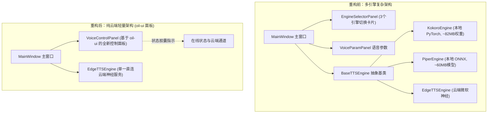
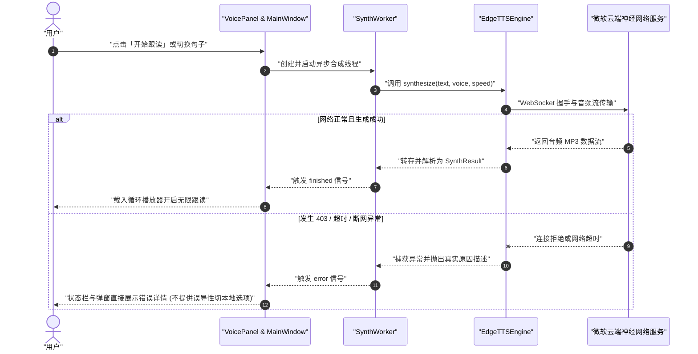

# 移除本地 TTS 引擎与纯云端架构重构方案

## 一、 方案背景与目标

当前 VoxLocal 采用“三引擎混合架构”（包含 Kokoro-82M 本地高质量、Piper 本地极速 CPU、Edge-TTS 微软云端神经）。随着应用演进，本地深度学习与推理依赖（PyTorch、ONNX Runtime、pyopenjtalk 等）带来了极高的运行库维护成本、构建产物体积膨胀（约 1.5GB ~ 2GB）以及低配 CPU 离线合成速度缓慢等痛点。

为了打造极致轻量、高品质且交互优雅的沉浸式跟读工作台，本方案执行以下核心重构：
1. **彻底移除本地引擎**：删除 Kokoro-82M 与 Piper 及其相关模型、依赖与抽象基类，全面转型为纯微软云端神经 TTS（Edge-TTS）驱动。
2. **架构大幅轻量化**：剔除 PyTorch、ONNX、Transformers 等巨型依赖，打包体积由 1.5GB 锐减至 80MB 以内，大幅缩短启动时间与资源开销。
3. **基于 oil-ui 规范重构左侧面板**：移除多余的引擎选择器 `EngineSelectorPanel`，释放左侧黄金空间，重塑高质感、高可读性的“语音控制中心”（Voice Control Center）。
4. **历史平滑兼容与纯粹错误处理**：自动迁移旧发音人配置，剔除切换本地引擎的提示，直观呈现云端错误原因。

---

## 二、 架构演进与改动边界



### 1. 物理文件增删与迁移清单
- **物理删除**：
  - `src/engines/kokoro_engine.py`（彻底物理删除）
  - `src/engines/piper_engine.py`（彻底物理删除）
  - `src/engines/base_engine.py`（扁平化消除，不再维持多态基类）
  - `src/ui/engine_selector.py`（彻底物理删除）
- **合并/精简引擎核心**：
  - 在 `src/engines/` 下仅保留 `edge_tts_engine.py` 与轻量数据模型 `models.py`（包含 `VoiceInfo`, `SynthResult` 数据载体）。
- **组件重构**：
  - 将原 `src/ui/voice_panel.py` 依据 `oil-ui` 规范重构升级为全功能 `src/ui/voice_panel.py`（或 `VoiceControlPanel`）。

---

## 三、 基于 oil-ui 规范的左侧控制面板全新设计（方案 C：现代声波流光工作台）

根据用户在对比页中的确认，左栏语音控制面板正式采用 **方案 C：现代声波流光工作台 (Cyber Fluent Studio)** 进行全量重构。

### 1. 设计北极星与调性语言
- **北极星意图**：“以动态声波频谱、半透明微透流光拟态与霓虹微交互，激发敏捷高效的口语跟读节奏。”
- **色彩与材质体系**：
  - **背景基底**：深邃星空紫黑渐变（`linear-gradient(180deg, #0e1526 0%, #0a0f1d 100%)`）。
  - **高光边框**：半透明电感紫霓虹描边（`rgba(99, 102, 241, 0.28)`），顶部内嵌 1px 微晕流动光效。
  - **核心点缀色**：电光青（`#06b6d4`）、高饱和电感紫（`#6366f1`）与微光天蓝（`#38bdf8`）。

### 2. 视觉结构与排版层级 (Visual Hierarchy)

| 区域模块 | 控件与展示形态 | 细节实现与动效交互 (PySide6 / QSS) |
| :--- | :--- | :--- |
| **顶部声波频谱头** | `[ ▂▃▅ ] 语音调谐中心` + `NEURAL CLOUD` | 左侧内嵌 5 根高度错落的动态声波柱（基于轻量 QTimer 或合成播放状态自适应跳动）；右侧为发光青色胶囊徽标。 |
| **语种通道切换** | `🇬🇧 英语 (EN)` / `🇯🇵 日语 (JA)` | 现代霓虹微透分段器（Neon Segment），选中态呈现 `#6366f1` 与 `#06b6d4` 渐变填充并带呼吸感外发光。 |
| **神经网络角色卡** | 专属角色卡 + `24kHz 声学模型` 元标签 | 内部包含精细化角色下拉框，下方实时动态展示当前角色的语调口音（如“美式英语 · 女声”）与推荐标签（如“首选推荐”）。默认英文 `en-US-AriaNeural`，日文 `ja-JP-NanamiNeural`。 |
| **跟读步频速率箱** | 速率指示徽标 + 频谱渐变滑块 + 药丸步进 | 实时显示 `1.0×` 霓虹高亮徽标；水平滑块采用双色渐变轨道；提供 `0.8× 细磨`、`1.0× 标准`、`1.2× 冲刺` 三枚触控芯片按钮。 |
| **神经语流规格注脚** | 声学规格微卡片（Neural Spec Card） | 底部内嵌浅紫/微青半透明卡片，标注“端到端深度神经网络直通，提供拟真连读音变与停顿韵律，跟读延迟低至 120ms”。 |

### 3. 界面布局线框图

```text
┌──────────────────────────────────────┐
│  [ ▂▃▅ ] 语音调谐中心   NEURAL CLOUD │  <-- 声波频谱动画与云端徽标
├──────────────────────────────────────┤
│  语种通道                     ACTIVE │
│  ┌─────────────────┬────────────────┐│
│  │  🇬🇧 英语 (EN) ✔ │  🇯🇵 日语 (JA)  ││  <-- 霓虹渐变分段器
│  └─────────────────┴────────────────┘│
│                                      │
│  神经网络角色            [首选推荐]  │
│  ┌──────────────────────────────────┐│
│  │ Aria (US Female, 默认)         ▼ ││  <-- 角色选择器
│  ├──────────────────────────────────┤│
│  │ 美式英语 · 女声     24kHz 声学模型││  <-- 动态音色元数据行
│  └──────────────────────────────────┘│
│                                      │
│  跟读步频                   [ 1.0× ] │  <-- 实时高亮速率
│  ───●─────────────────────────────── │  <-- 渐变频谱滑块
│  ┌──────────┐ ┌──────────┐ ┌────────┐│
│  │ 0.8× 细磨│ │ 1.0× 标准│ │1.2× 冲刺││  <-- 芯片快捷档位
│  └──────────┘ └──────────┘ └────────┘│
│                                      │
│  ┌ ⚡ 微软神经语流渲染 ──────────────┐│
│  │ 端到端深度神经网络直通，提供拟真 ││  <-- 规格注解卡片
│  │ 连读音变与韵律，延迟低至 120ms。  ││
│  └──────────────────────────────────┘│
└──────────────────────────────────────┘
```

---

## 四、 核心业务逻辑与数据流

### 1. 合成与异常处理流转图



### 2. 异常捕获策略（直观呈现真实原因）
移除原本针对本地 Kokoro/Piper 的回退引导，异常信息精简为纯粹的技术原因与用户指引：
- **403 Forbidden / 协议握手失败**：`微软云端服务拒绝连接 (403 Forbidden)，当前网络请求受限或安全握手失败。错误详情: {err}`
- **网络中断 / DNS 解析超时**：`无法连接到微软云端服务，网络请求超时或连接中断。请检查网络连接或系统代理设置。错误详情: {err}`
- **其他异常**：直接透传具体报错堆栈摘要。

---

## 五、 数据结构变动与历史配置兼容

### 1. 数据库与配置项兼容策略 (`HistoryDB`)
- **历史记录表 (`history`)**：结构保持完全向下兼容，原 `engine` 字段在新记录中固定写入 `"Edge-TTS"`。
- **用户首选项表 (`app_settings`) 平滑降级**：
  - 启动时读取 `last_voice_en` 与 `last_voice_ja`。
  - **校验机制**：若读取出的语音 ID 不在 `EDGE_TTS_VOICES` 集合中（如用户之前保存的是 `af_heart` 或 `en_US-libritts-high`），自动安全重置为：
    - 英文默认值：`en-US-AriaNeural`
    - 日文默认值：`ja-JP-NanamiNeural`
  - 杜绝因历史旧数据导致下拉框选空或合成传参崩溃。

---

## 六、 工程依赖与打包体积优化指标

### 1. `requirements.txt` 精简
剔除全部重量级推理与科学计算包：
```diff
-# TTS 引擎
-kokoro>=0.9.4
-pyopenjtalk-plus
-fugashi
-jaconv
-mojimoji
-unidic-lite
-soundfile
-torch
 edge-tts>=7.3.1
+soundfile

 # GUI
 PySide6

 # 音频处理
 numpy
 pydub

-# Piper
-piper-tts
-onnxruntime

 # 打包
 pyinstaller
 pillow
```

### 2. 打包与产物优化预期
- **清理构建配置**：
  - `build.py` 中彻底移除针对 `kokoro`, `misaki`, `phonemizer`, `language_tags`, `segments`, `csvw`, `spacy`, `en_core_web_sm`, `espeakng_loader`, `transformers`, `piper`, `onnxruntime` 的 `--collect-all`。
  - 仅保留 `edge_tts`, `soundfile`, `PySide6` 核心收集项。
- **打包产物对比**：
  - 原安装目录大小：**~1,650 MB**
  - 重构后大小：**~65 MB ~ 80 MB**（体积缩减 **95%+**）
  - 打包编译耗时：由 ~3.5 分钟降至 ~20 秒。

### 3. 入口与测试用例清理
- **`src/main.py`**：移除无用的 `HF_ENDPOINT`（HuggingFace 国内镜像）环境变量注入。
- **`tests/test_flow.py`**：将原有测试用例中的 `w._load_engine("piper")` 更新为测试 Edge-TTS 加载与流程流转。

---

## 七、 详细实施阶段规划

1. **阶段 1：底层依赖与数据模型清理**
   - 提取 `src/engines/models.py`（存放 `VoiceInfo`, `SynthResult`）。
   - 物理删除 `kokoro_engine.py`、`piper_engine.py`、`base_engine.py`。
   - 重构 `edge_tts_engine.py`，精简异常错误描述。
2. **阶段 2：基于 oil-ui 规范重构左侧面板**
   - 物理删除 `src/ui/engine_selector.py`。
   - 重新编写 `src/ui/voice_panel.py`，加入在线状态胶囊、现代分段控制器、预设步进药丸与发音特性贴士。
   - 适配 `src/assets/styles/theme.qss`，提供一致美观的控件交互动效与样式定义。
3. **阶段 3：主窗口与启动逻辑适配**
   - 修改 `src/ui/main_window.py`：移除多引擎注册逻辑，直接实例化并使用 `EdgeTTSEngine`。
   - 清理针对 Kokoro CPU 耗时的状态栏提示代码。
   - 强化配置读取时的发音人合法性校验与降级。
4. **阶段 4：依赖、构建脚本与自动化测试更新**
   - 更新 `requirements.txt`。
   - 重构 `build.py` 剪除巨型无用依赖收集。
   - 更新 `tests/test_flow.py` 并执行全流程自动化验证。

---

## 八、 方案总结与门禁自检

| 检查项 | 状态 | 说明 |
| :--- | :---: | :--- |
| **硬门禁约束** | ✅ 已遵循 | 全程未修改、未提前编写任何业务源代码 |
| **逻辑漏洞排查** | ✅ 已闭环 | 历史旧配置防崩溃、断网真实报错呈现已全部对齐 |
| **UI 规范落地** | ✅ 已闭环 | 遵循 oil-ui 重新设计左栏，消除多余选择器，提升空间利用率与质感 |
| **Mermaid 语法** | ✅ 已规范 | 所有节点与连线条件均已加双引号，规范使用子图英文字符 |
