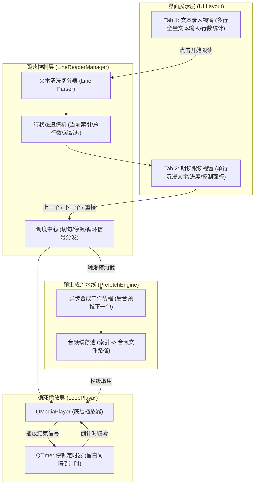
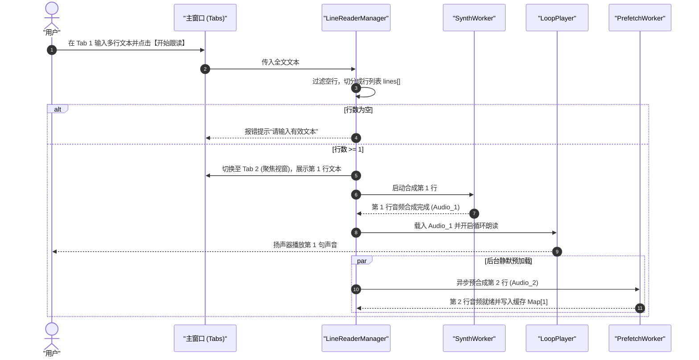
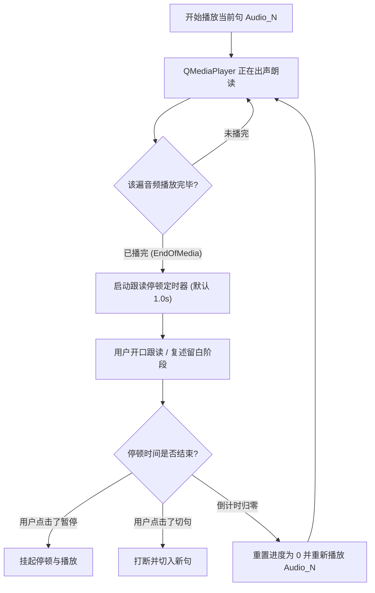
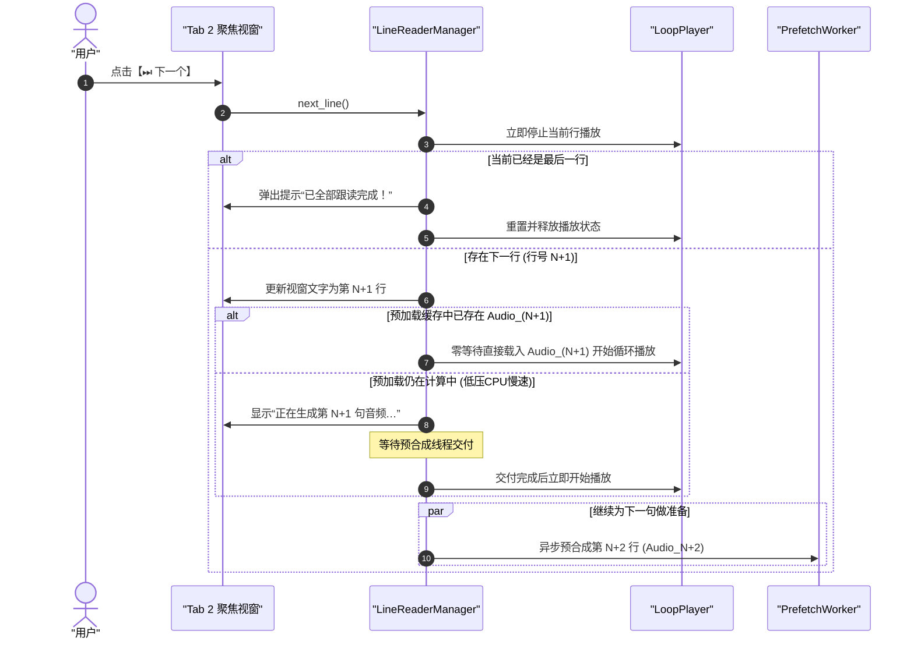

# 逐行循环朗读与跟读系统方案设计

## 一、需求背景与业务定位

### 1.1 背景与痛点
现有 VoxLocal 系统采用“整段文本一次性输入并全量合成”模式。在针对英语口语跟读、影子训练（Shadowing）、句子精听听写（Dictation）等语言学习场景时，暴露出明显痛点：
1. **整篇合成过长**：无法针对单个句子进行反复精听与模仿发音；
2. **缺乏断句与无限循环**：用户跟读需要单句重复朗读多次，听懂学会后才进入下一句；
3. **合成等待时延大**：在纯 CPU 环境下，整篇合成耗时极长；而逐行按需切分并配合预加载，可将等待时间降至最低；
4. **界面视觉焦点分散**：多行大文本容易干扰视线，用户需要一个大字体、高专注度、仅显示当前正朗读句子的沉浸式跟读视窗。

### 1.2 业务目标
将 VoxLocal 的语音合成与播放体系重构为**“逐行切分、单行无限循环朗读、按键切换下一行”**的专属跟读工作台：
- **全文输入与沉浸朗读分离**：通过两个独立 Tab 分工（Tab 1 存储全量课文文本，Tab 2 沉浸式朗读视窗仅展示当前行）；
- **逐行驱动与单行无限循环**：以换行 `\n` 为切分基准，每句自动无限循环朗读；
- **智能留白停顿**：每次单句读完与下一次重复之间，自动留出停顿间隔（默认 1 秒，可自主调节），供用户复述跟读；
- **完备控制链**：提供【上一个】、【下一个】、【暂停 / 继续】、【重播本句】等核心控制；
- **后台异步流水线预生成**：当前行在循环播放时，后台静默异步预生成下一行音频，点击【下一个】时实现零等待无缝切入；
- **尾行自动完结**：末行朗读完毕点击【下一个】时，温和提示“已全部跟读完成”并自动停止。

---

## 二、需求澄清决策矩阵

根据与用户的业务澄清，形成以下强约束基准：

| 维度 | 决策方案 | 详细说明 |
| :--- | :--- | :--- |
| **模式交互形态** | **直接全局重构替换** | 全局切换为逐行跟读模式，主界面采用 Tab 架构。 |
| **界面 Tab 规划** | **Tab 1: 文本录入 Tab 2: 朗读聚焦** | Tab 1 存储全部文本并解析总行数；点击开始后自动切入 Tab 2，Tab 2 仅以大字体展示当前正朗读的单行文本。 |
| **单行切分与清洗** | **换行切分 + 空行过滤** | 按 `\n` 切分为句子数组，自动过滤掉空行、纯空格行及无有效字符行。 |
| **循环逻辑与停顿** | **无限循环 + 留白停顿** | 当前句播放完毕后进入短暂静音停顿（默认 1.0 秒，支持调节 0.5s~5.0s），停顿结束后自动重播，直至用户切换。 |
| **控制按键集合** | **核心四键控制** | 提供【⏮ 上一个】、【▶/⏸ 暂停/继续】、【⏭ 下一个】、【🔄 重播本句】。不额外绑定键盘快捷键，保证纯粹 UI 点击操作。 |
| **后台预生成策略** | **全异步双缓冲流水线** | 当前正在播放第 $N$ 行时，后台 Worker 立即静默预合成第 $N+1$ 行；已播音频内存/磁盘缓存，切回前一句同样秒播。 |
| **末行边界处理** | **友好完结提示** | 当位于最后一行并点击【下一个】时，停止循环，弹出或状态栏提示“已全部跟读完成”。 |

---

## 三、系统架构与模块设计

系统整体分为四个核心层：**视图层 (UI Tabs)**、**跟读控制层 (Reader Controller)**、**循环播放引擎 (Loop Player Engine)**、**流水线预合成池 (Prefetch Pipeline)**。

### 3.1 架构分层图

### 3.2 模块职责定义

1. **`LineReaderManager` (跟读核心控制器)**
   - 负责输入文本的多行切分、空行清理与合法性验证；
   - 维护当前行索引 `current_index` 与行总数 `total_lines`；
   - 驱动切句逻辑：`next_line()`、`prev_line()`、`replay_current()`；
   - 协调音频播放与后台异步预生成任务。

2. **`LoopPlayer` (带停顿的循环播放组件)**
   - 封装 `QMediaPlayer` 与 `QAudioOutput`；
   - 捕获 `mediaStatusChanged(EndOfMedia)` 信号；
   - 激活留白定时器 `QTimer`，经过设定停顿秒数（默认 1.0s）后再次调用 `play()` 形成物理无缝重复；
   - 提供播放中瞬时暂停、恢复功能。

3. **`PrefetchEngine` (异步双缓冲预生成引擎)**
   - 基于 `QThread` 运行，优先级低于当前播放，防止 UI 卡顿；
   - 音频缓存字典：`Dict[int, SynthResult]`，保留已生成行的音频临时文件，避免反复合成；
   - 预生成策略：每当切入第 $i$ 行并开始播放时，立即在后台检测第 $i+1$ 行是否已存在缓存；若无，立即启动后台线程静默合成。

4. **`FocusReadPanel` (朗读聚焦面板 - Tab 2)**
   - **顶部状态栏**：显示当前进度（如 `句 3 / 12`）与完成度百分比；
   - **中央视窗**：沉浸式卡片，超大号字体（20~24px）、呼吸感间距展示当前单句文本；
   - **控制栏**：
     - 【⏮ 上一个】：返回上一句并立即播放（若为首句则置灰）；
     - 【▶ / ⏸ 暂停/继续】：切换播放暂停状态；
     - 【🔄 重播本句】：打断停顿或重置当前句从头播放；
     - 【⏭ 下一个】：切入下一句（末句触发完结）；
     - 【⏱ 跟读停顿】：滑动条或步进器（0.5s ~ 5.0s，步长 0.5s，默认 1.0s）。

---

## 四、核心交互与控制时序流程

### 4.1 启动与首次切句流程

### 4.2 单行无限循环播放时序 (含跟读留白停顿)

### 4.3 切换下一句（【⏭ 下一个】）交互时序

---

## 五、异常与边界控制

1. **纯空行与特殊符号行处理**
   - 过滤逻辑：`lines = [line.strip() for line in raw_text.splitlines() if line.strip()]`；
   - 若用户输入的文本全是换行或空格，点击开始时给出阻断提示 `QMessageBox.warning("无有效行", "请输入包含文字的文本内容")`。

2. **引擎不可用防呆机制**
   - 在开始跟读前，若当前选中的 TTS 引擎未就绪（如模型缺失），直接阻止切换 Tab 并标红提示，杜绝进入空白死锁。

3. **快速连点【下一个】的并发竞态防护**
   - 如果用户在极短时间内连续点击【下一个】，此时若后续音频尚未生成完毕，系统采用**防抖机制 (Debounce)**：
     - 将按钮置为“等待中”状态；
     - 取消或顺延无用的中间句预合成任务，直接将算力倾斜至用户最终停留的那一行。

4. **单句过长的自适应布局**
   - Tab 2 的中央句子展示卡片采用 `QScrollArea` + 自动换行 `QLabel` 或只读富文本框，即使整段长达 100 词也能优雅展示，字体动态在 18px ~ 24px 之间微调。

---

## 六、UI 界面视觉设计规范（互联网暗黑现代风）

遵循高质感互联网现代设计风格，保持深色科技主题：
- **主 Tab 栏 (QTabWidget)**：
  - 胶囊型切换按钮，深灰底色 `#161b22`，选中态高亮边框 `#388bfd` 并附带柔和发光投影；
  - Tab 1 标签名：`📝 课文文本库`
  - Tab 2 标签名：`🎧 沉浸跟读台`
- **Tab 2 沉浸跟读台视觉层级**：
  - **进度条指示器**：顶部细长渐变发光进度条（青蓝渐变 `#2ea043` -> `#388bfd`），标注如 `第 3 / 10 句 (30%)`；
  - **核心单句卡片**：
    - 背景：深邃半透明磨砂质感 `#0d1117`，边框 `1px solid #30363d`，圆角 `12px`；
    - 文字：现代无衬线字体（Inter / Segoe UI / 微软雅黑），字号 `22px`，行高 `1.6`，字重 `500`，字色 `#f0f6fc`；
  - **控制按键组**：
    - 【⏮ 上一个】：简约幽灵按钮，悬浮微亮；
    - 【▶ / ⏸ 播放暂停】：中央大主色调按钮（亮青蓝 `#238636` 或 `#1f6feb`），图标清晰醒目；
    - 【🔄 重播】：中性操作按钮，重置当前句；
    - 【⏭ 下一个】：高亮轮廓按钮；
    - 【⏱ 停顿调节】：水平滑块附带数值气泡（如 `跟读停顿: 1.0 秒`）。

---

## 七、实施计划与开发门禁

根据 `.agents/SKILL/requirement-analysis` 强约束规范，在用户明确确认并同意本设计方案之前，**严禁修改任何代码**。

### 阶段规划（待审核通过后执行）：
1. **阶段 1：核心数据模型与播放控制器重构**
   - 编写 `LineReaderManager` 与 `LoopPlayer`，实现换行拆分与带停顿循环逻辑；
   - 编写后台双缓冲预合成 Worker。
2. **阶段 2：UI Tab 重组与沉浸跟读视窗开发**
   - 在主界面引入 `QTabWidget`；
   - 将原输入框归入 Tab 1；
   - 新建 `FocusReadPanel` 并挂载至 Tab 2，连接核心控制事件与停顿滑块。
3. **阶段 3：全链路联动、防抖与测试验证**
   - 测试空行过滤、上一个/下一个切句边界、末行完结提示；
   - 测试后台异步预生成流水线在 Kokoro 与 Piper 下的表现；
   - 进行完整打包验证。
